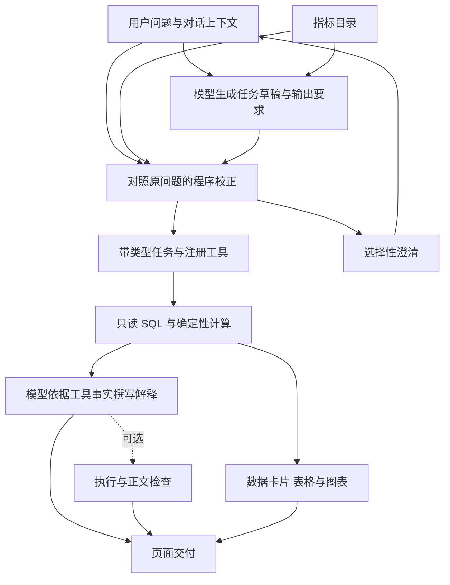

# EduTA 系统架构

EduTA（Education Typed-task Analyst，教育数据的带类型任务分析助手）面向学校数字化评价中的整体、维度和题项分析。模型理解问题并生成解释，程序校正任务并计算数值。

## 分析流程

## 任务与输出要求

分析任务可概括为 `T = (O, F, Y, I, A, V, M)`，输出要求另记为 `S`。

| 字段 | 含义 |
|---|---|
| O | 学校或地区对象 |
| F | 学段、城乡等筛选条件 |
| Y | 年度 |
| I | 整体、维度或题项指标 |
| A | 均值、排名、差值、比值等运算，以及操作数方向和聚合方式 |
| V | 原始值或归一化得分 |
| M | 零值和空值的处理规则 |
| S | 用户要求报告的数值、比较关系、样本量和图表 |

模型根据指标目录提出草稿。程序将原问题中的明确要求与草稿比对，恢复题项、年度、筛选条件和输出项，核对差值方向，并构造多个关联子任务。仍有歧义时，系统保存当前任务，等待用户选择后继续执行。

## 工具与统计定义

学校评估、地区评估、题项取值、比较、跨年分析和排名分别由注册工具执行。工具通过固定查询结构和参数绑定读取 SQLite 数据，在程序中完成计算。模型接收任务字段和工具结果，不生成 SQL。

统计工具区分原始计数、归一化得分、地区内学校等权均值、作答池化均值及学校模板加权分。零值参与统计，SQL 空值从相应统计中排除。数据卡片、表格和图表直接使用计算结果，图表支持预览与 PNG 下载。

## 模块关系

| 模块 | 职责 |
|---|---|
| `apps/web`、`apps/api` | 会话交互、接口和页面呈现 |
| `packages/semantic_query` | 目录解析、程序校正、任务编译、输出要求和答复检查 |
| `packages/agent`、`scripts` | 工具注册、业务查询、统计计算和图表生成 |
| `packages/analysis_contract` | 任务与结果绑定、只读重算和执行核验 |
| `packages/core` | 数据适配、凭据存储和本机会话 |
| `packages/llm_gateway` | 模型服务访问 |

## 可选检查

论文中的核心配置 G1 使用模型解析和解释、程序校正及确定性工具。G2、G2NR 和 G2W 在这条链路上分别增加“检查并改写后扣下未通过正文”“检查后扣下正文”和“检查后保留正文并提醒”的处理方式。数据卡片和图表使用工具计算值。

普通启动保留现有智能语义模式及其检查流程；方法配置的选择见 [运行配置](RUNNING.md)。大模型语义检查器默认关闭。
